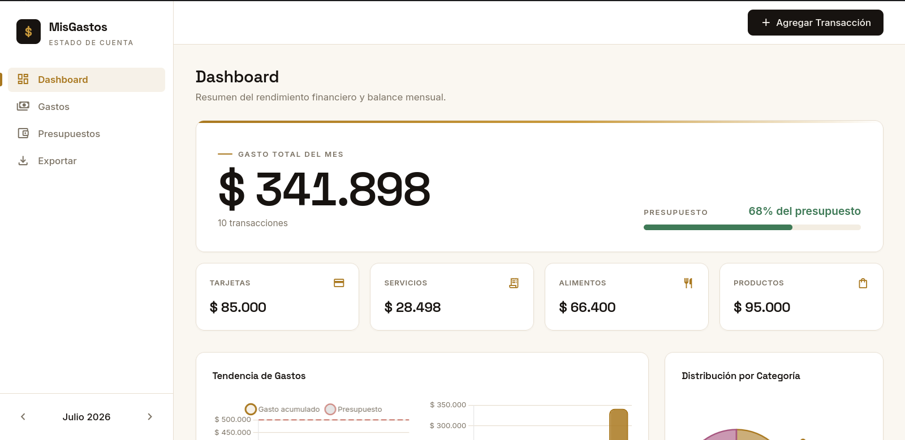
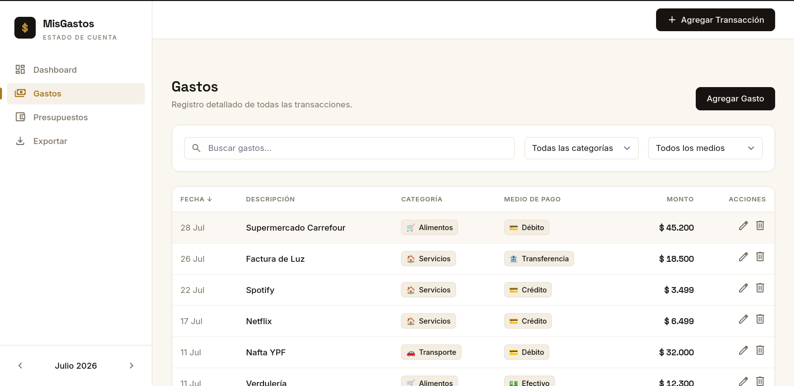
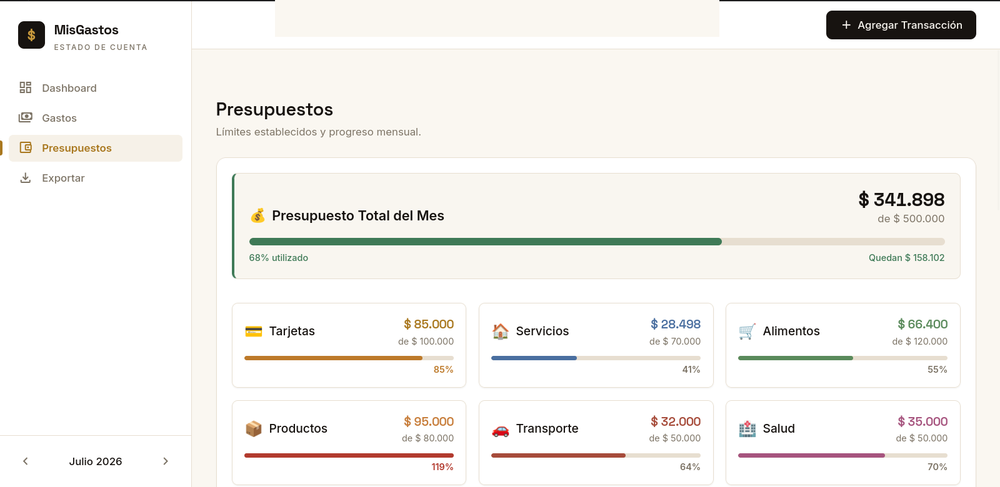
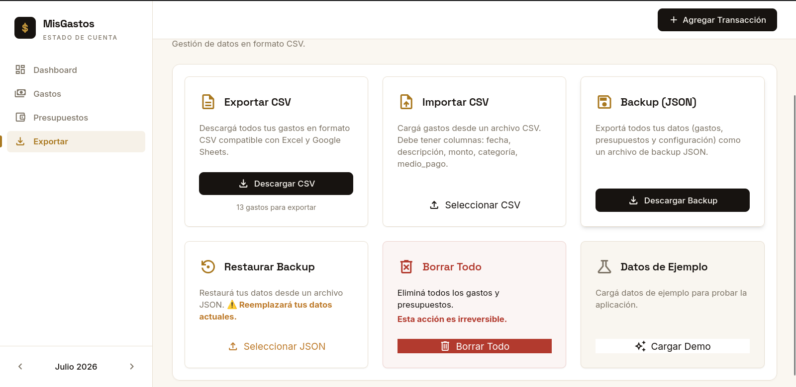

# MisGastos

Dashboard de finanzas personales con **front y back en Django**. Registra gastos,
maneja presupuestos por mes y muestra tendencias, con persistencia en PostgreSQL
vía el ORM de Django. El frontend (diseño "estado de cuenta") se sirve como
template + estáticos, y la API vive en `/api/*`.

## Capturas

| Dashboard | Gastos |
|---|---|
|  |  |
| **Presupuestos** | **Exportar / Importar** |
|  |  |

## Stack

- Python 3.12–3.14, Django 6.0.9 y PostgreSQL (14 o posterior).
- Frontend con JavaScript, estilos Tailwind compilados y Chart.js servido localmente.
- Node.js 24 o posterior para compilar los assets y ejecutar las pruebas del frontend.

## Acceso y datos

Aplicación personal: sólo las cuentas activas con `is_superuser=True` pueden abrir el dashboard o usar la API. No hay registro público. Las cuentas comunes y staff sin privilegios de superusuario no acceden a las finanzas. El panel `/admin/` conserva las reglas propias de Django.

Los datos forman un único conjunto privado compartido por las cuentas administradoras. No es un servicio multiusuario: antes de ofrecerlo a personas independientes se debe agregar propiedad y aislamiento de datos.

Todas las escrituras exigen sesión y CSRF. El frontend confirma la respuesta del servidor antes de actualizar la pantalla; un fallo conserva el formulario. Los datos sólo se cachean en memoria, sin nuevas copias financieras en localStorage. Al abrir, no se generan gastos de muestra automáticamente.

## Desarrollo local

1. Crear un entorno e instalar dependencias:

```bash
python3 -m venv venv
source venv/bin/activate
pip install -r requirements.txt
```

2. Si no existe `.env`, copiar `.env.example`. Si ya existe, conservarlo y completar las variables nuevas. Generar una clave propia con:

```bash
python -c "import secrets; print(secrets.token_urlsafe(64))"
```

Guardar la clave en `DJANGO_SECRET_KEY` y configurar `DATABASE_URL` con la base PostgreSQL dedicada. Las contraseñas con caracteres reservados deben codificarse para URL. `.env` no se sube a Git.

3. Con la base funcionando, aplicar migraciones y crear tu cuenta:

```bash
python manage.py migrate
python manage.py createsuperuser
python manage.py runserver
```

Abrir `http://127.0.0.1:8000/`: redirige al login. Para desarrollo local usar `DJANGO_DEBUG=True`. La configuración de producción exige una clave de al menos 50 caracteres y hosts concretos, activa cookies seguras y redirige a HTTPS.

Los estilos y gráficos compilados están versionados, por lo que Node.js no es necesario en el VPS. Después de modificar templates, clases o dependencias del frontend:

```bash
npm ci --ignore-scripts
npm run build
```

## Validación

Pruebas portátiles con SQLite en memoria; no leen `.env` ni acceden a tu base personal:

```bash
python manage.py test Gastos --settings=Proyecto.test_settings
npm test
```

Pruebas contra PostgreSQL: usar una **base de pruebas dedicada** y un rol con `CREATEDB`, nunca credenciales de producción. Con esas variables cargadas:

```bash
python manage.py test Gastos
python manage.py makemigrations --check --dry-run
```

GitHub Actions ejecuta la suite contra un PostgreSQL temporal, las pruebas de JavaScript y la compilación de assets. Las pruebas de DOM no sustituyen la revisión visual y de comportamiento en un navegador real.

## Importación, exportación y borrado

- CSV agrega o combina gastos; valida el archivo completo y confirma una única transacción. Soporta campos entre comillas, comas y saltos de línea. Se requieren las columnas Fecha, Descripción, Monto y Categoría; Medio de Pago y Notas son opcionales.
- Los montos admiten hasta dos decimales con punto decimal, sin separador de miles. Los gastos deben ser mayores que cero; los presupuestos pueden ser cero.
- JSON restaura el conjunto completo, incluida la configuración. Solicita confirmación y reemplaza los datos en una transacción: si falla, se revierte todo.
- Se admiten archivos de hasta 2 MB y hasta 2000 gastos/presupuestos por importación. Para volúmenes mayores usar backups nativos de PostgreSQL.
- Borrar todo y cargar la demo requieren confirmación. La demo reemplaza el conjunto actual; exportar un backup antes de usarla.
- El CSV neutraliza fórmulas en campos de texto al exportar a planillas. Usar JSON para conservar los textos sin esa transformación e incluir presupuestos y configuración.
- Si usabas una versión anterior, exportá y verificá tus datos antes de actualizar: las copias antiguas que hubiera en localStorage no se importan automáticamente.

## API privada

| Método | Ruta | Descripción |
|---|---|---|
| GET / POST | `/api/expenses` | listar / crear o actualizar por identificador |
| PUT / DELETE | `/api/expenses/<id>` | editar / borrar un gasto |
| DELETE | `/api/expenses` | borrar gastos, presupuestos y configuración |
| GET / POST | `/api/budgets` | listar / guardar presupuestos |
| GET / POST | `/api/settings` | leer / guardar configuración |
| GET / POST | `/api/backup` | snapshot / importar con modo `merge` o `replace` |

POST, PUT y DELETE requieren `X-CSRFToken`. Los errores de validación devuelven 400; sin sesión, los GET devuelven 401; una cuenta sin permiso devuelve 403. Una escritura sin token CSRF también devuelve 403. Los meses del contrato de presupuestos siguen indexados desde cero (`2026-0` = enero).

## Publicación en VPS

Seguir [docs/DEPLOY.md](docs/DEPLOY.md). Se incluyen `.env.production.example`, un servicio Gunicorn y una configuración Nginx para adaptar al dominio. No son un despliegue ejecutado.

Antes de migrar una base existente, respaldarla y revisar gastos con monto no positivo, presupuestos negativos y categorías/medios de pago desconocidos. La migración nueva no corrige ni borra esos datos automáticamente.

## Estructura

```text
Proyecto/             configuración, WSGI y settings de pruebas
Gastos/models/        entidades y restricciones de base
Gastos/repositories/  acceso a datos
Gastos/services/      operaciones e importaciones transaccionales
Gastos/views/         endpoints privados y CSRF
Gastos/validation.py  validación común de la API y los archivos
Gastos/static/        JavaScript y assets compilados
Gastos/tests/         regresiones del backend
frontend/tests/      persistencia, DOM y CSV
frontend/            fuentes y compilación de assets
deploy/              ejemplos para systemd y Nginx
```
